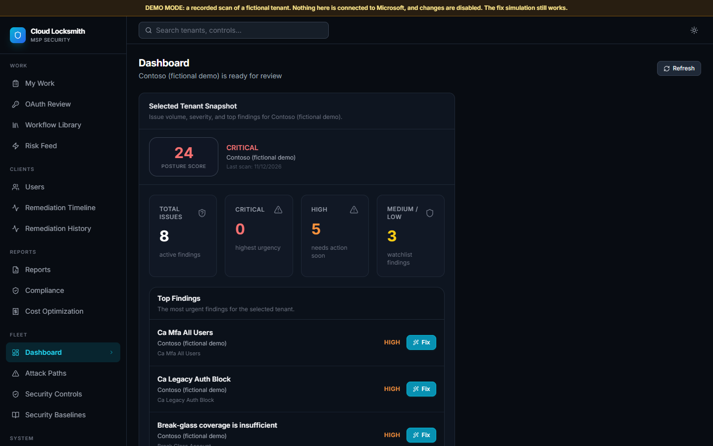
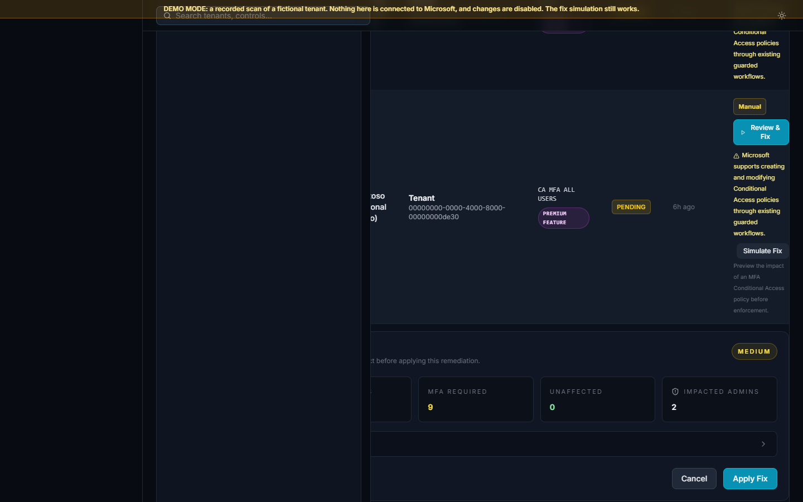

# Cloud Locksmith Core

Cloud Locksmith Core scans Microsoft 365 / Entra ID tenants for identity and Conditional
Access misconfigurations, scores the tenant's posture, and fixes findings through an
approval-gated workflow with verification and rollback. It is multi-tenant, so an MSP can
run it across client tenants.

Status: **0.1.1**. AGPL-3.0. See `CHANGELOG.md` for what changed since the first open-source release (0.1.0).

## Try the demo (no Microsoft account needed)

Requires Docker with Compose.

```
git clone <this repository> cloud-locksmith-core
cd cloud-locksmith-core
docker compose up --build
```

Then open http://localhost:3000 and click **Sign in to the demo**.

The demo shows a recorded scan of a fictional tenant ("Contoso (fictional demo)"): posture
score and history, findings, risk feed, attack paths, and the **Simulate Fix** preview. It
makes no Microsoft calls, needs no `.env`, and refuses every change except the simulation.
A first `docker compose up --build` builds the images: in two measured runs from a fresh
clone it took 7 and 10 minutes, mostly installing the dashboard's npm packages (base images
were already downloaded; allow extra time for those). Later starts take seconds. The fix buttons are shown but any change is refused, and
the dashboard does not yet explain the refusal beyond the demo banner.





If another program already listens on port 3000 (for example a local `npm run dev`), your
browser may reach it instead of the demo. Stop it first.

Stop it with `docker compose down` (add `-v` to delete the demo database).

## What it does

| Capability | Status | How it is verified |
|---|---|---|
| Scan 27 identity and Conditional Access controls (`docs/controls.md`) | Implemented | Unit tests. Scans run against a real developer tenant on 2026-11-12 (predecessor code) and 2026-11-13 (this code, including a read-only check of the stale service principal, service-account and risk-based Conditional Access controls). |
| Posture score, history and trend | Implemented | Unit tests; demo |
| Risk feed and attack-path grouping | Implemented | Unit tests; demo |
| Fix preview for MFA Conditional Access policies (Simulate Fix) | Implemented | Unit tests; demo; real tenant on 2026-11-12 (predecessor code) |
| Approval-gated fixes with preflight checks, verification and rollback (`docs/remediation-lifecycle.md`) | Implemented | Unit and Postgres integration tests. On a real developer tenant (2026-11-13): one Conditional Access fix (block legacy authentication, report-only) approved, executed, verified and rolled back twice, tenant restored; refusals checked (no break-glass account, expired approval, stale sign-in, concurrent execute). No enforced fix and no other fix has been run against a real tenant. |
| Multi-tenant access control and tenant isolation | Implemented | Unit and Postgres integration tests, including cross-tenant cases |
| MSP fleet view, baselines and campaigns | Implemented | Unit tests |
| Evidence reports (PDF) | Implemented | Unit and integration tests, with PDF rendering stubbed |
| OAuth app consent review workflow | Implemented | Unit tests |
| Read-only demo mode with guards | Implemented | `backend/tests/test_demo_mode.py`; the demo stack was started and checked end to end (the CI workflow repeats that check) |

## What it does not do

No threat detection or real-time alerting on sign-ins. No coverage of Defender, Intune,
Exchange Online configuration or Purview. It is not a replacement for Microsoft's own
tools. Automatic remediation exists but is **off by default** and should stay off until
you have read `docs/remediation-lifecycle.md`.

## Use it with your own tenant

See `docs/connect-a-real-tenant.md` and `docs/permissions.md`.

## Docs

* `docs/architecture.md`: components, request path, identity, background jobs.
* `docs/controls.md`: every control, generated from the code.
* `docs/remediation-lifecycle.md`: approve, execute, verify, roll back; auto-remediation.
* `docs/permissions.md`: every Microsoft Graph scope requested, and why.
* `docs/threat-model.md`: tenant isolation, OAuth, tokens, demo-mode guards.

## Development

Backend (Python 3.10 or 3.11):

```
cd backend
pip install -r requirements-dev.txt
ruff check . && ruff format --check .
pytest -q
```

Tests that need Postgres skip unless `DATABASE_URL` points at a migrated database whose
name ends in `_test` (they truncate tables). CI runs them against Postgres 15.

Dashboard (Node 20):

```
cd dashboard
npm ci
npm run lint && npm run typecheck && npm run format:check
npx jest
```

## Contributing and security

Contributions are welcome under a Contributor License Agreement: see `CONTRIBUTING.md`
and `CLA.md`. Report vulnerabilities privately as described in `SECURITY.md`.

## Licence

GNU Affero General Public License v3.0 (`LICENSE`). If you run a modified version as a
network service, the AGPL requires you to offer its source to that service's users.
